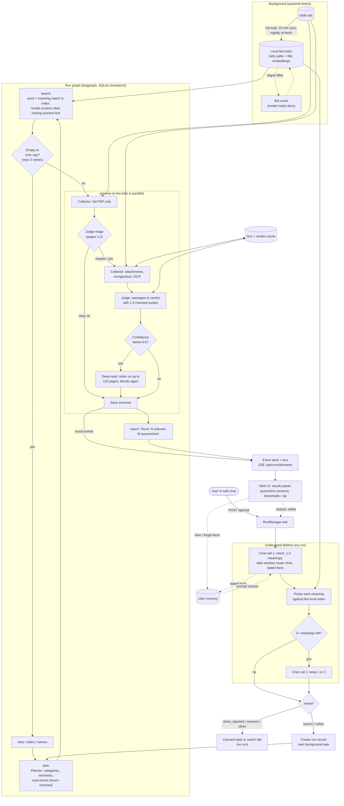

# GeM Tender Agent — Overview

## The business problem

Companies that sell to the Indian government have to watch GeM (Government e-Marketplace), which lists about 40,000 open bids at any time. Finding the bids that matter is slow manual work:

- **Titles are vague.** Many bids are filed as "Custom Bid for Services – …", so keyword search misses them or returns noise.
- **The answer is in the documents.** You only know whether a bid fits after reading the bid PDF, the RFP, the scope of work and any corrigenda.
- **Volume and deadlines.** New bids appear every day and close within weeks. Missing one means losing the revenue.

## What the app does

The user types a plain-language request into a chat, for example *"tender documents for anti money laundering published in the last 2 weeks"*. The agent then:

1. Works out what the user means, without asking them to confirm, and says which meaning it used.
2. Searches **every** matching open bid, not just the first page of results.
3. Downloads each candidate's bid PDF, attachments and corrigenda, using OCR where needed.
4. Reads the documents and gives a **verdict** for each bid, with quotes giving the file and page.
5. Shows the relevant bids with buyer, dates, value and a reason, plus downloads and a zip. Bids that don't match go to **quarantine** for 30 days, where the user can restore them.

It learns each user's preferences (user memory). Results start streaming within minutes.

## Tech stack

| Layer | Choice |
|---|---|
| Language | Python 3.11 (`uv`), TypeScript |
| Orchestration | LangGraph, with a SQLite checkpointer so runs resume after a crash |
| Agents | pydantic-ai, with outputs enforced by a JSON schema |
| LLM | Local Qwen (`qwen3.6-35b-a3b`) behind an OpenAI-compatible server (LM Studio / vLLM) |
| Retrieval | bge-m3 embeddings, bge-reranker-v2-m3, BM25, fusion (PyTorch locally, or remote over HTTP) |
| Site access | httpx with a per-host rate limiter (≥1 s, 4 s after errors); Playwright planned as a fallback |
| Documents | pypdf, PyMuPDF, Tesseract OCR, openpyxl, python-docx, archive extraction |
| Storage | SQLite (bid index, checkpoints), file caches for documents and verdicts, JSON for memory |
| Backend | FastAPI, with Server-Sent Events for live results |
| Frontend | React 19 + Vite, tested with Vitest |
| Ops | systemd timers: index sync every 15 min, full re-fetch nightly |
| Sandbox (planned) | pydantic-monty, for skills the model writes itself |

## Layout

```
gem_agent/
├── gem_agent/
│   ├── cli.py            # gem-agent CLI: chat, serve, index, eval, backfill-queries
│   ├── config.py         # settings from .env
│   ├── app/              # FastAPI backend: ask, SSE events, runs, downloads, memory
│   ├── graph/            # langgraph run graph, RunState, checkpointer, event store, RunManager
│   ├── agents/           # chat, planner, searcher, collector, judge, reporter, memory step
│   ├── tools/            # HTTP client + rate limiter, GeM tools, PDF/OCR, office/archive text, browser
│   ├── retrieval/        # bge-m3 embeddings, reranker, BM25, fusion, chunking
│   ├── index/            # local open-bid index: sync, query, probe, bid cards
│   ├── cache/            # document, verdict and lookup caches, pre-fetch
│   ├── memory/           # user memory, saved topic meanings, run log
│   ├── harness/          # capabilities, ladder, discovery, skills, checks, Monty sandbox (stubs)
│   ├── jobs/             # retention, saved searches, query-date backfill
│   └── eval/             # scoring the Judge against the labelled set
├── web/                  # React 19 + Vite chat UI
├── tests/                # pytest suite + recorded GeM and document fixtures (live tests: -m live)
├── eval/                 # labelled set, candidate selection, labelling material
├── deploy/systemd/       # index sync (15 min) and nightly re-fetch timers
├── skills/               # saved skills + records (empty until the harness exists)
├── knowledge/            # users/<user>/memory.json, topics/
└── data/                 # bids.sqlite, cache/, runs/ (not in git)
```

## Flow

Solid arrows are the main path; dotted arrows are side effects. Parts not built yet (see the end of this file) are left out.


**Steps**

- **Local index, in the background.** `index/sync.py` loads all of GeM's open bids once, then syncs every 15 minutes and re-fetches everything nightly. New titles get embeddings. For bids with vague titles, `index/cards.py` writes a bid card from the bid's documents. Searches read this index, not the live site.
- **Understand.** `agents/chat.py` turns the message into an intent and 1–3 possible meanings, and checks each meaning against the index. A second model call picks between them only if two or more are left. Facts the user states go straight into user memory.
- **Run or reply.** A search or refinement creates a run that executes as a background task (`graph/manager.py`). Anything else, such as "show rejected" or a question about memory, gets a reply and starts no run.
- **Run graph.** plan → search → widen or narrow (at most 2 retries) → process → report (`graph/build.py`). Every step is checkpointed, so a run stopped by a crash or restart resumes when the app starts again.
- **Process each bid.** The Collector fetches the bid PDF, and the Judge's triage reads its first pages. Only bids that pass have their attachments fetched and get a full verdict (see [How the Judge decides](#how-the-judge-decides)). Documents and verdicts are cached across runs and users.
- **Stream.** Each outcome goes to the web UI over SSE as soon as it is saved. `/api/runs/{id}/events` replays a run and then follows it live, so the user can leave the page and come back.
- **After the run.** The user restores quarantined bids, downloads files or a zip, refines the request (a follow-on run that reuses the cache), and views or forgets memory facts.

## How the Judge decides

The Judge (`agents/judge.py`) decides whether one bid is really about the user's topic. It decides on meaning, not matching words, and must back a "relevant" verdict with quotes from the documents.

**The topic definition.** Every prompt starts with the topic: what it means, its terms and acronyms, look-alikes that are **not** the topic, and things that are related but not enough on their own.

1. **Triage.** The model reads the title, buyer and pages 1–2 of the bid PDF and answers `clearly_no`, `maybe` or `clearly_yes`. A clear no is final: the bid is quarantined without its attachments being downloaded. GeM's auto-filled "Similar Category" list never counts as evidence.
2. **Pick passages.** For bids that pass, the Judge builds a context of about 13k tokens from every readable file: passages that best match the topic (BM25 + bge-m3 embeddings, reranked), scope-of-work and eligibility passages, the opening page of every attachment, and passages likely to state the last date for queries. GeM's general terms, which are the same for every bid, are left out.
3. **Verdict.** The model returns relevant or not, a confidence, a reason, key facts, the queries deadline and 1–3 quotes, each citing a file and page.
4. **Check the quotes.** Each quote is looked up on the page it cites. If it isn't there, the other pages and files are searched and the citation is corrected. The model is asked again, once each time, when:
   - a "relevant" verdict has no quote that can be found, or
   - every quote comes from the first pages of the bid PDF, which only repeat the listing. The model is told to quote an attachment or the buyer's own terms instead.
5. **Deep read.** If confidence is still below 0.6, the model takes notes on the largest attachments, 20 pages at a time and up to 120 pages, then decides again with those notes added.
6. **Result.** A relevant bid goes to the results panel and anything else to quarantine. A relevant verdict that still has no verified quote from beyond the title pages is flagged **needs review**, and its confidence is capped at 0.5. The UI shows what the quotes prove (*documents*, *title only* or *none*) instead of the model's own confidence, which was almost always 0.85 or higher. Verdicts are cached by bid, topic and a hash of the documents, so a new corrigendum triggers a fresh verdict.

## What's left to implement

**Not built (modules are one-line stubs):**
- **Harness**: Monty sandbox host modules, checks, discovery, skill builder and skill library (`harness/`). The agent can't yet write its own code when the site changes.
- **Browser fallback** (`tools/browser.py`). When an HTTP route fails, that bid fails.
- **Reporter** (`agents/reporter.py`). The report today is only "Done: N relevant, M quarantined", with no summary table or `summary.md`.
- **Saved and scheduled searches** (`jobs/saved_searches.py`, `app/routes/saved_searches.py`), and the nightly pre-fetch for saved topics (`cache/prefetch.py`).
- **Retention clean-up** (`jobs/retention.py`): quarantine after 30 days, zips, old run logs.
- **Detailed run log** (`memory/run_log.py`): every request, tool call and model call.

**Built but not wired in:**
- **Post-run memory step** (`agents/memory_step.py`). Nothing calls it, so learned facts never appear and restores aren't learned from.
- **Daily request budget.** The setting (20,000) is never enforced.
- **Mid-run corrections.** A message sent during a run starts a follow-on run instead of re-planning the current one.
- **Daily re-check of reported bids.** No job tells the user when a closing date moves.
- **Deleting by hand.** There is no API to delete a run or all of a user's data.

**In progress / pending review:**
- **Borderline bids.** The Judge will say "borderline" and ask the user one question; the user's ruling is remembered. The design and plan exist, but nothing is implemented.
- **Labelled evaluation set.** 23 flagged labels and 2 disagreements need human review before precision and recall can be relied on.

**Out of scope for now:** CPPP/GePNIC and bank tender portals, closed or awarded bids, and anything that needs a GeM login.
