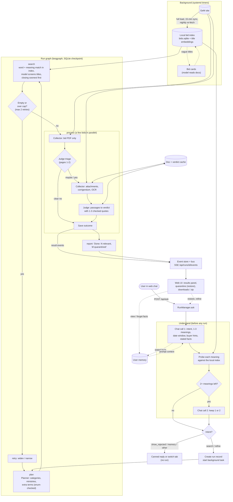

# GeM Tender Agent — App Flow

How a request moves through the app as built on 17 Nov 2026. The design is in [GEM_TENDER_AGENT.md](GEM_TENDER_AGENT.md); its section numbers are given in brackets.

Solid arrows are the main path; dotted arrows are side effects. The diagram leaves out what is not built yet: the post-run memory step, the harness (7), saved searches and retention (see 14.1 of the spec).

## Steps

1. **Local index, in the background** (6.2): `index/sync.py` does a full load of GeM's open bids once, then syncs every 15 minutes and re-fetches everything nightly. New titles get embeddings. For vague titles, `index/cards.py` writes a bid card from the bid's documents. Searches read this index, not the live site.
2. **Understand** (5.3): `agents/chat.py` turns the message into an intent and 1–3 candidate meanings. It checks each meaning against the index, and a second call chooses between them only if two or more are left. Stated facts go straight into user memory.
3. **Run or reply** (`graph/manager.py`): a search or refinement creates a run that executes as a background task. Anything else (show rejected, memory questions) gets a reply on the current stream and starts no run.
4. **Run graph** (`graph/build.py`, 5.1): plan → search → (widen or narrow, at most 2 retries) → process → report. Every step is checkpointed, so a run interrupted by a crash or restart resumes when the app starts.
5. **Process each bid** (5.4): the Collector fetches the bid PDF and triage reads its first pages. Only bids that pass have their attachments fetched and a full verdict written, with quotes checked against the cited pages. Documents and verdicts are cached across runs and users.
6. **Stream** (4.1): each outcome is streamed to the web UI over SSE as soon as it is saved. `/api/runs/{id}/events` replays a run and then follows it live, so the page can be rejoined.
7. **Borderline bids** (4.1, 5.5): a bid the Judge cannot call without the user comes back as borderline with a question. The user rules "counts" or "doesn't count" in the web UI; the ruling becomes a per-topic memory fact, settles the run's other bids that raise the same question, and decides similar bids in later runs. Undo removes a fact the click created and un-settles what it settled. The run never waits.
8. **After the run**: the user restores quarantined bids, downloads files or a zip, refines the request (a follow-on run that reuses the cache), and views or forgets memory facts.
