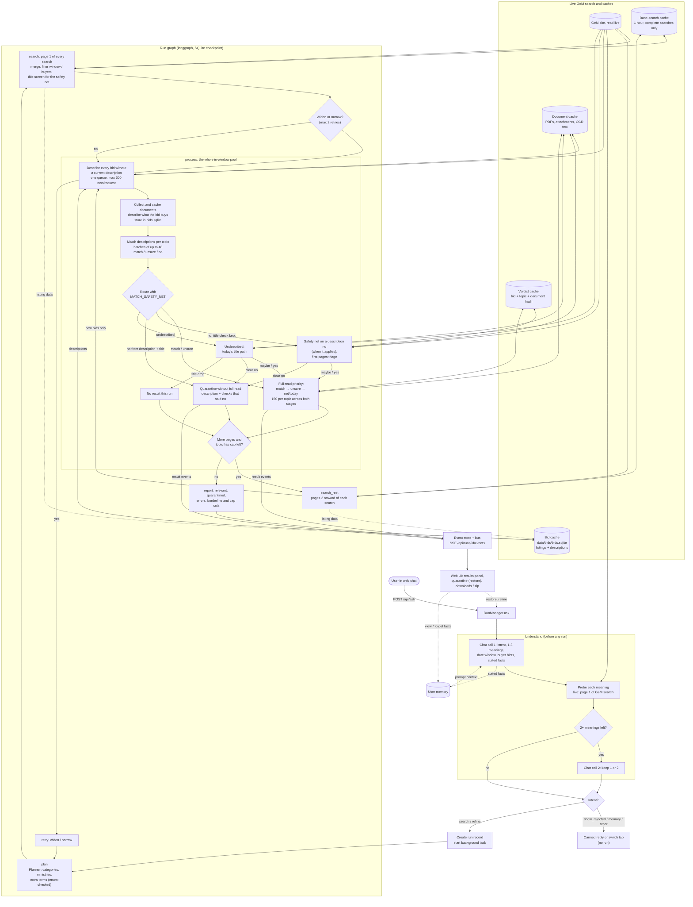

# GeM Tender Agent — App Flow

How a request moves through the app as built on 24 Nov 2026. The shipped describe-once design is in [describe-once-design.md](superpowers/specs/2026-11-24-describe-once-design.md).

Solid arrows are the main path; dotted arrows are side effects. The diagram leaves out what is not built yet: the post-run memory step, the harness, saved searches and the nightly pre-fetch.

## Steps

1. **Live search and caches**: no bids are loaded in the background. Each topic's plan runs fixed base searches plus its category, buyer and term searches. Stage 1 reads page 1 of every search; stage 2 reads remaining pages while the topic still has room under its read cap. Complete base searches are cached for an hour in `data/cache/searches/`, so another run within the hour can reuse them. Listing data for every in-window search hit goes to the bid cache, `data/bids/bids.sqlite`, whether the title screen keeps it or not.
2. **Understand** (`agents/chat.py`): the message becomes an intent and 1–3 candidate meanings. Each meaning is probed live on GeM (page 1 of up to three of its terms), and a second call chooses between them only if two or more remain. Stated facts go straight into user memory.
3. **Run or reply** (`graph/manager.py`): a search or refinement creates a run that executes as a background task. Anything else, such as "show rejected" or a memory question, gets a reply on the current stream and starts no run.
4. **Run graph** (`graph/build.py`): plan → search → optional widen/narrow (at most two retries) → process → search_rest → process only new bids → report. The first process gets the **whole in-window pool**: title-screen keeps, title-screen drops and cap cuts. The checkpoint and durable process sidecar preserve the stage, completed bids, descriptions written and per-topic reads, so a resumed run does not repeat work or exceed a limit.
5. **Describe once** (`index/describe.py`, `index/db.py`): every pool bid without a current description has its documents collected and cached, then is described from the bid document, RFP sections and up to three attachments. One row per bid is stored in the `descriptions` table of `data/bids/bids.sqlite`, with its subject, terms, sources, buyer, document hash, model and prompt version. Later runs and users reuse it; changed documents cause a rewrite when next collected. One shared queue allows **300 new descriptions per request across all topics and both stages**. Bids beyond that cap are reported as not yet described, not rejected, and use today's title/first-pages path.
6. **Match per topic** (`agents/matcher.py`): current descriptions and their buyers are matched to each topic in batches of **up to 40**, returning match / unsure / no. A failed batch is split once; a half that still fails is treated as unsure. Similarity only orders description work and never drops a bid.
7. **Safety net** (`graph/deciding.py`): `MATCH_SAFETY_NET=true` by default and only a person changes it. When the net applies, a description **no** is checked against the old title-screen result and, if the title was kept, gets first-pages triage. Triage's clear no is final; maybe or yes earns a full read. With the net off, a description no drops a bid only when the description has a scope section; otherwise it still takes the old path. Undescribed bids always take the old title path, then triage if the title was kept, regardless of the setting.
8. **Full read**: bids are selected for full reading in the order **match → unsure → net/today**, closing soonest first within each group. The **150-full-read cap is per topic and shared across both stages and all three groups**. A few selected bids are then read in parallel. The Collector supplies attachments, corrigenda and OCR text; the Judge selects passages, writes the verdict and checks its quotes. The UI records why the bid was read: matches, might match or kept by the title check. Bids beyond the cap are reported, not quarantined.
9. **Borderline bids**: a bid the Judge cannot call without the user comes back as borderline with a question. The user rules "counts" or "doesn't count" in the web UI; the ruling becomes a per-topic memory fact, settles the run's other bids that raise the same question, and decides similar bids in later runs. Undo removes a fact the click created and un-settles what it settled. The run never waits.
10. **Quarantine**: a bid ruled out without a full read carries a reason such as `Not a match: buys <subject>. Ruled out by the description check and the title check.` When the safety net's first-pages check also says no, the reason names **the description check and the first-pages check** instead. A clear-no triage on the old path carries the Judge's reason. Quarantined bids are kept for 30 days and can be restored.
11. **Stream** (`graph/events.py`, `graph/views.py`): each outcome goes to the web UI over SSE as soon as it is saved. `/api/runs/{id}/events` replays a run and then follows it live, so the page can be rejoined.
12. **After the run**: the user restores quarantined bids, downloads files or a zip, refines the request (a follow-on run that reuses the descriptions, documents and verdicts), and views or forgets memory facts.
13. **Refresh and evaluate**:
    - `gem-agent describe --refresh` re-describes selected cached bids without GeM requests. `--limit N` defaults to 200.
    - `gem-agent eval match` replays the current matcher, today's title/first-pages path, and their union on the labelled set using cached documents only. It repeats three times by default and reports checked-label misses, all misses, non-matches read, model calls and the missed tenders; buyer topics are scored separately.
    - The safety net may be retired only after the **current matcher prompt** misses **no human-checked label in three runs in a row** on subject topics. The harness prints whether that evidence holds. It never changes `MATCH_SAFETY_NET`; a person decides and flips the setting. Labels still awaiting human review are not retirement evidence.
