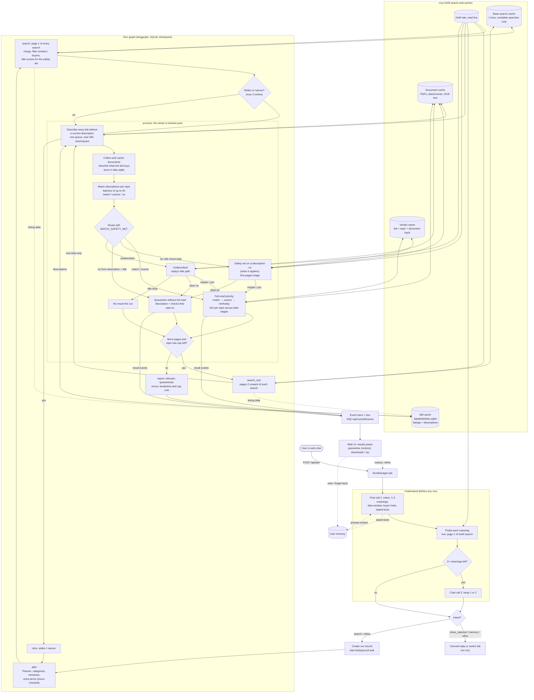

# GeM Tender Agent — Overview

## The business problem

Companies that sell to the Indian government have to watch GeM (Government e-Marketplace), which lists about 40,000 open bids at any time. Finding the bids that matter is slow manual work:

- **Titles are vague.** Many bids are filed as "Custom Bid for Services – …", so keyword search misses them or returns noise.
- **The answer is in the documents.** You only know whether a bid fits after reading the bid PDF, the RFP, the scope of work and any corrigenda.
- **Volume and deadlines.** New bids appear every day and close within weeks. Missing one means losing the revenue.

## What the app does

The user types a plain-language request into a chat, for example *"tender documents for anti money laundering published in the last 2 weeks"*. The agent then:

1. Works out what the user means, without asking them to confirm, and says which meaning it used.
2. Searches GeM live in two stages: page 1 of every search, then remaining pages while each topic is under its cap. It keeps the **whole in-window pool**, including bids the title screen drops.
3. **Describes each bid once** from its documents into `data/bids/bids.sqlite`: at most **300 new descriptions per request**, shared across all topics and both stages, then reused by every later run and user.
4. Matches descriptions to each topic in batches of **up to 40**: match / unsure / no. The old title screen and first-pages triage remain a **safety net** for description misses. `MATCH_SAFETY_NET=true` by default, and only a person turns it off.
5. Selects full reads in the order **match → unsure → net/today**, closing soonest first within each group, with a **150-read cap per topic across both stages**. It downloads attachments and corrigenda, uses OCR where needed, and gives each read bid a **verdict** with quotes giving the file and page.
6. Shows relevant bids with buyer, dates, value and a reason, plus downloads and a zip. Bids ruled out without a full read go to **quarantine** for 30 days with the available description and the checks that said no, so the user can inspect and restore them.

It learns each user's preferences (user memory). Results start streaming within minutes.

## Tech stack

| Layer | Choice |
|---|---|
| Language | Python 3.11 (`uv`), TypeScript |
| Orchestration | LangGraph, with a SQLite checkpointer so runs resume after a crash |
| Agents | pydantic-ai, with outputs enforced by a JSON schema |
| LLM | Local Qwen (`qwen3.6-35b-a3b`) behind an OpenAI-compatible server (LM Studio / vLLM) |
| Retrieval | all-MiniLM-L6-v2 page embeddings (or a remote server), optional reranker, BM25, fusion (spec 3.5.1) |
| Site access | httpx with a per-host rate limiter (≥1 s, 4 s after errors); Playwright planned as a fallback |
| Documents | pypdf, PyMuPDF, Tesseract OCR, openpyxl, python-docx, archive extraction |
| Storage | SQLite (bid cache, checkpoints), file caches for documents, verdicts and base searches, JSON for memory |
| Backend | FastAPI, with Server-Sent Events for live results |
| Frontend | React 19 + Vite, tested with Vitest |
| Sandbox (planned) | pydantic-monty, for skills the model writes itself |

## Layout

```
gem_agent/
├── gem_agent/
│   ├── cli.py            # gem-agent CLI: chat, serve, bids, describe, eval, jobs
│   ├── config.py         # settings from .env
│   ├── app/              # FastAPI backend: ask, SSE events, runs, downloads, memory
│   ├── graph/            # langgraph run graph, RunState, checkpointer, event store, RunManager
│   ├── agents/           # chat, planner, searcher, collector, judge, matcher, reporter, memory step
│   ├── tools/            # HTTP client + rate limiter, GeM tools (live search), PDF/OCR, office/archive text, browser
│   ├── retrieval/        # MiniLM / bge-m3 embeddings, reranker, BM25, fusion, chunking
│   ├── index/            # bid cache (bids.sqlite): listings, descriptions, refresh and migration
│   ├── cache/            # document, verdict, lookup and base-search caches, pre-fetch
│   ├── memory/           # user memory, saved topic meanings, run log
│   ├── harness/          # capabilities, ladder, discovery, skills, checks, Monty sandbox (stubs)
│   ├── jobs/             # retention, saved searches, query-date backfill
│   └── eval/             # scoring the Judge and description matching against the labelled set
├── web/                  # React 19 + Vite chat UI
├── tests/                # pytest suite + recorded GeM and document fixtures (live tests: -m live)
├── eval/                 # labelled set, candidate selection, labelling material
├── deploy/tei/           # embedding and rerank services (TEI) for the model host
├── skills/               # saved skills + records (empty until the harness exists)
├── knowledge/            # users/<user>/memory.json, topics/
└── data/                 # bids/bids.sqlite (bid cache), cache/, runs/ (not in git)
```

## Flow

Solid arrows are the main path; dotted arrows are side effects. Parts not built yet (see the end of this file) are left out.


**Steps**

- **Live search and the pool.** No bids are loaded in the background. Stage 1 reads page 1 of every planned search; stage 2 reads remaining pages while each topic has room under its cap. Complete base searches are cached for an hour, so another run within the hour can reuse them. Every in-window search hit is stored in `data/bids/bids.sqlite` and enters the pool, including title-screen drops and cap cuts.
- **Understand.** `agents/chat.py` turns the message into an intent and 1–3 possible meanings, and checks each meaning live on GeM (page 1 of up to 3 of its terms). A second model call picks between them only if two or more are left. Facts the user states go straight into user memory.
- **Run or reply.** A search or refinement creates a background run (`graph/manager.py`). Anything else, such as "show rejected" or a question about memory, gets a reply and starts no run.
- **Run graph.** plan → search → widen or narrow (at most 2 retries) → process the whole stage-1 pool → search_rest → process only new bids → report (`graph/build.py`). The checkpoint and durable process sidecar preserve the stage, completed bids, descriptions written and per-topic reads across a restart.
- **Describe once.** The Collector caches each missing bid's documents, and `index/describe.py` describes what it buys from the bid document, RFP sections and up to three attachments. One row per bid is stored in the `descriptions` table of `data/bids/bids.sqlite`, with its document hash, model and prompt version. It is reused by every later run and user; changed documents cause a rewrite when next collected. A single queue allows **300 new descriptions per request across all topics and both stages**. Bids beyond that limit are reported as not yet described, not rejected, and use today's title/first-pages path.
- **Match per topic.** `agents/matcher.py` sends current descriptions and their buyers in batches of **up to 40**, returning match / unsure / no. A failed batch is split once; a half that still fails becomes unsure. Similarity only orders description work and never drops a bid.
- **Safety net.** `MATCH_SAFETY_NET=true` by default, and only a person changes it. When the net applies, a description **no** is checked against the old title-screen result and, if the title was kept, gets first-pages triage. Maybe or yes earns a full read; clear no goes to quarantine. With the net off, a description no drops a bid only when the description has a scope section; otherwise it still takes the old path. Undescribed bids always take the old title path, then triage if the title was kept, regardless of the setting.
- **Full read.** Bids are selected in the order **match → unsure → net/today**, closing soonest first within each group. The **150-full-read cap is per topic and shared across both stages and all three groups**; a few selected bids are then read in parallel. The Judge selects passages, gives a verdict and checks its quotes (see [How the Judge decides](#how-the-judge-decides)). Documents and verdicts are cached across runs and users. The UI says whether a read bid matched, might match or was kept by the title check; cap cuts are reported rather than quarantined.
- **Quarantine and stream.** A bid ruled out without a full read carries a reason such as `Not a match: buys <subject>. Ruled out by the description check and the title check.` If the safety net's first-pages check also says no, the reason names **the description check and the first-pages check**. Quarantine keeps bids for 30 days and allows restoration. Each outcome streams over SSE as soon as it is saved; `/api/runs/{id}/events` replays a run and then follows it live.
- **After the run.** The user restores quarantined bids, downloads files or a zip, refines the request (a follow-on run that reuses descriptions, documents and verdicts), and views or forgets memory facts.

### Refreshing descriptions and retiring the safety net

`gem-agent describe --refresh` re-describes selected cached bids without GeM requests. `--limit N` defaults to 200.

`gem-agent eval match` replays the description matcher alone (safety net off), today's title/first-pages path, and their union on the labelled set, using cached documents only. It repeats three times by default and reports checked-label misses, all misses, non-matches read, model calls and the missed tenders. Buyer topics are scored separately.

The safety net may be retired only when the **current matcher prompt** misses **no human-checked label in three runs in a row** on subject topics. The harness prints whether that evidence holds; it never changes `MATCH_SAFETY_NET`. A person decides and flips the setting. Labels still awaiting human review are not retirement evidence.

## How the Judge decides

The description matcher routes bids before this stage. The Judge (`agents/judge.py`) decides whether one routed bid is really about the user's topic. It decides on meaning, not matching words, and must back a "relevant" verdict with quotes from the documents.

**The topic definition.** Every prompt starts with the topic: what it means, its terms and acronyms, look-alikes that are **not** the topic, and things that are related but not enough on their own.

1. **First-pages check.** The model reads the title, buyer and pages 1–2 of the bid PDF and answers `clearly_no`, `maybe` or `clearly_yes`. A clear no is final and goes to quarantine. On the safety-net or undescribed path, this check decides whether the bid earns a full read without downloading its attachments. On a full-read path it still runs inside the Judge before the verdict. GeM's auto-filled "Similar Category" list never counts as evidence.
2. **Pick passages.** For bids that pass, the Judge builds a context of about 13k tokens from every readable file: passages that best match the topic (BM25 + MiniLM or remote embeddings, optionally reranked), scope-of-work and eligibility passages, the opening page of every attachment, and passages likely to state the last date for queries. GeM's general terms, which are the same for every bid, are left out.
3. **Verdict.** The model returns relevant or not, a confidence, a reason, key facts, the queries deadline and 1–3 quotes, each citing a file and page.
4. **Check the quotes.** Each quote is looked up on the page it cites. If it isn't there, the other pages and files are searched and the citation is corrected. The model is asked again, once each time, when:
   - a "relevant" verdict has no quote that can be found, or
   - every quote comes from the first pages of the bid PDF, which only repeat the listing. The model is told to quote an attachment or the buyer's own terms instead.
5. **Deep read.** If confidence is still below 0.6, the model takes notes on the largest attachments, 20 pages at a time and up to 120 pages, then decides again with those notes added.
6. **Result.** A relevant bid goes to the results panel and anything else to quarantine. A relevant verdict that still has no verified quote from beyond the title pages is flagged **needs review**, and its confidence is capped at 0.5. The UI shows what the quotes prove (*documents*, *title only* or *none*) instead of the model's own confidence, which was almost always 0.85 or higher. Verdicts are cached by bid, topic and a hash of the documents, so a new corrigendum triggers a fresh verdict.

## What's left to implement

**Built:**
- **Borderline bids** (`agents/schemas.py`, `graph/rulings.py`). The Judge can say a bid is borderline and ask the user one question. The user's ruling in the web UI is remembered as a per-topic memory fact, settles the run's other bids that raise the same question, and decides similar bids in later runs.
- **Retention**, on demand: `gem-agent retention [--dry-run] [--max-bids N]` deletes cached documents and verdicts past their window after closing (`jobs/retention.py`). Run logs and zips are not pruned.

**Not built (modules are one-line stubs):**
- **Harness**: Monty sandbox host modules, checks, discovery, skill builder and skill library (`harness/`). The agent can't yet write its own code when the site changes.
- **Browser fallback** (`tools/browser.py`). When an HTTP route fails, that bid fails.
- **Reporter** (`agents/reporter.py`). The report today is short counts for relevant, quarantined, unreadable, borderline and cap-cut bids, with no summary table or `summary.md`.
- **Saved and scheduled searches** (`jobs/saved_searches.py`, `app/routes/saved_searches.py`), and the nightly pre-fetch for saved topics (`cache/prefetch.py`).
- **Detailed run log** (`memory/run_log.py`): every request, tool call and model call.

**Built but not wired in:**
- **Post-run memory step** (`agents/memory_step.py`). Nothing calls it, so learned facts never appear and restores aren't learned from.
- **Daily request budget.** The setting (20,000) is never enforced.
- **Mid-run corrections.** A message sent during a run starts a follow-on run instead of re-planning the current one.
- **Daily re-check of reported bids.** No job tells the user when a closing date moves.
- **Deleting by hand.** There is no API to delete a run or all of a user's data.

**In progress / pending review:**
- **Labelled evaluation set.** 23 flagged labels and 2 disagreements need human review before precision and recall can be relied on.

**Out of scope for now:** CPPP/GePNIC and bank tender portals, closed or awarded bids, and anything that needs a GeM login.
